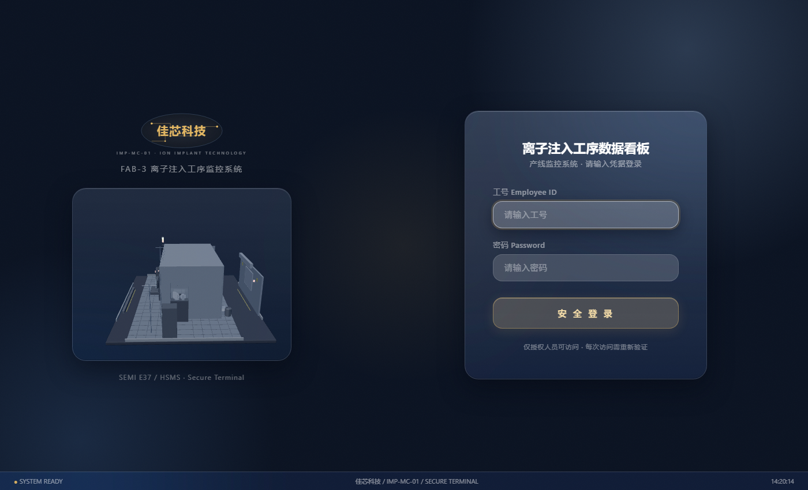
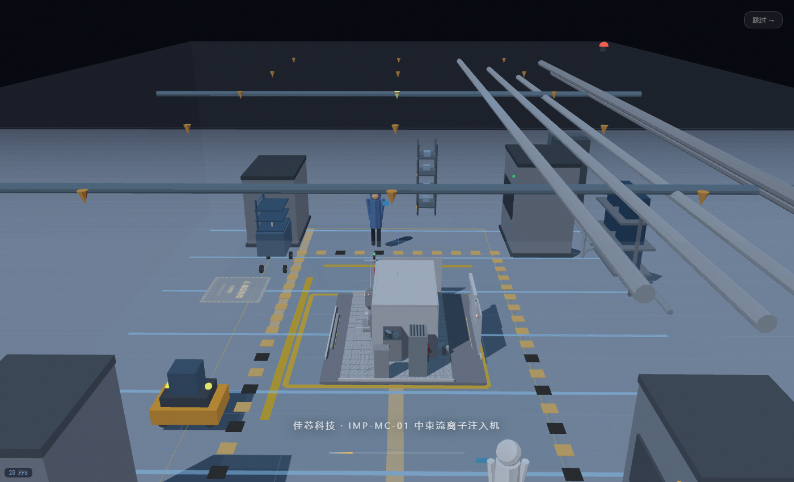
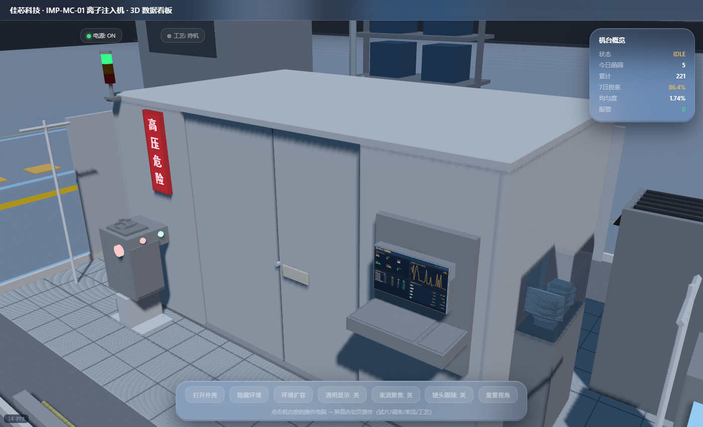
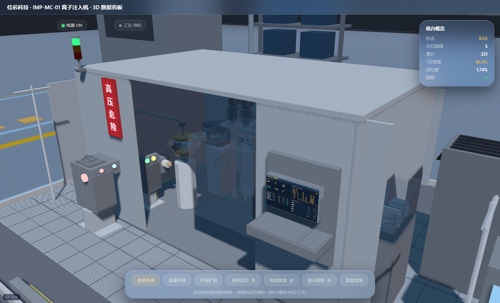
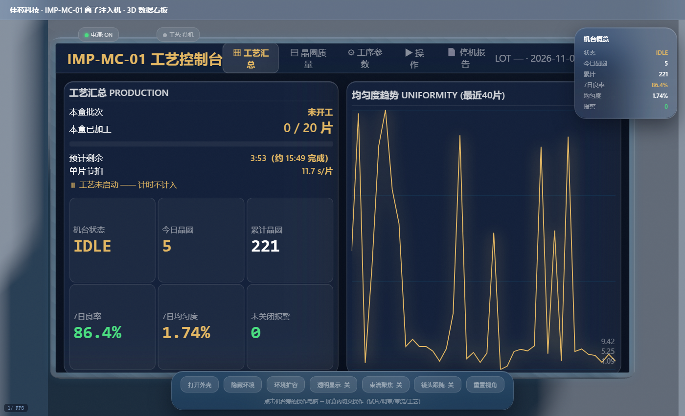
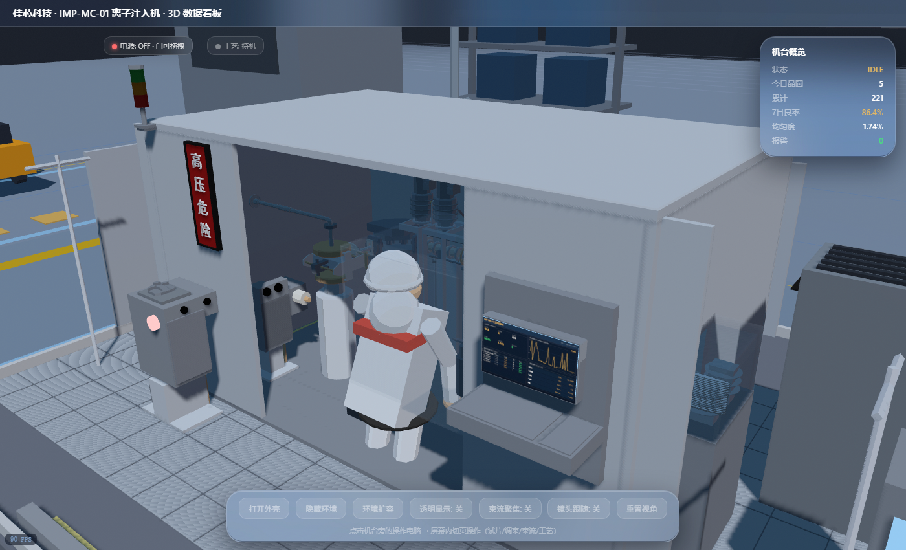
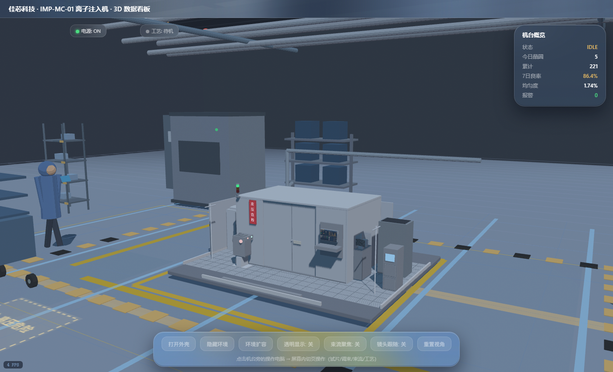

# 🔬 离子注入工序数据看板 IMP-MC-01

> 数据库综合实训项目 —— 从 Python 模拟器 → EMQX(MQTT) → MySQL → Flask → Nginx → 浏览器 → **Three.js 三维可视化** 的全链路工业数据看板。



---

## ✨ 项目亮点

- **Three.js 三维机台**：离子注入机完整内部结构建模（离子源 → 分析磁铁 → 加速管 → 扫描器 → 平行分化器 → 靶室），可拆壳查看、点击构件查看详情
- **实时数据驱动**：Python 模拟器通过 MQTT 发布晶圆数据，Flask 写入 MySQL，前端 5 秒轮询 KPI
- **Glassmorphism 玻璃拟态 UI**：深墨夜景 + 香槟金 accent + 毛玻璃面板的 Nocturne 设计风格
- **传片动画 + 束流动画**：机械臂 IK 取片 → 两道密封窗 → 抽真空 → 离子注入 → 质检 → 入成品晶舟
- **完整报警系统**：12 种报警类型（7 预警 + 5 宕机），操作员响应（呼叫工程师 → 检修倒计时 → 恢复）
- **三渲二 Cel-Shading**：Blender 端 ToonShader 节点组 + Bloom 合成，日漫风格色阶分层
- **一键部署**：双击 `.bat` 脚本自动建 venv、装依赖、建库导数据

---

## 📸 截图预览

| 过场动画 | 主界面 | 拆壳查看 |
|:---:|:---:|:---:|
|  |  |  |

| 操作电脑屏幕 | 工艺运行 | 停机维修 | 断电状态 |
|:---:|:---:|:---:|:---:|
|  |  |  |  |

---

## 🏗️ 技术架构

```
Python 模拟器 (implant_simulator.py)
    │ MQTT publish (port 1883)
    ▼
EMQX 4.4.19 (MQTT Broker)
    │ MQTT subscribe
    ▼
Python → MySQL (implant_to_db.py, port 3306)
    │
    ▼
Flask Web Server (implant_app.py, port 5001)
    │ HTTP API (/api/kpis, /api/wafers, /api/trend ...)
    ▼
Nginx 反向代理 (port 80) → 浏览器
    │
    ├── Three.js 三维机台 (implant_3d.html)
    ├── 操作电脑屏幕 UI (screen_ui.js)
    └── 2D 产线动画 (implant_index.html)
```

### 技术栈

| 层 | 技术 |
|---|---|
| 数据模拟 | Python 3.9 + paho-mqtt 1.6.1 |
| 消息中间件 | EMQX 4.4.19 (MQTT) |
| 数据库 | MySQL 8.0 (6 张表) |
| 后端 | Flask 3.1.3 + PyMySQL |
| 前端 3D | Three.js (GLTFLoader + OrbitControls) |
| 前端 UI | Glassmorphism CSS + Canvas 贴图 |
| 3D 建模 | Blender 4.4 (Cel-Shading + 烘焙动画) |
| 反向代理 | Nginx 1.27.4 |

---

## 📁 项目结构

```
IMP-space/
├── src/                        # 源码
│   ├── implant_app.py          # Flask 后端 (38KB)
│   ├── implant_simulator.py    # MQTT 数据模拟器 (26KB)
│   ├── implant_to_db.py        # MQTT→MySQL 桥接
│   ├── db_config.py            # 数据库配置
│   ├── templates/
│   │   ├── implant_3d.html     # Three.js 三维看板 (235KB)
│   │   ├── implant_index.html  # 2D 产线动画看板
│   │   └── login3d.html        # 登录页
│   └── static/
│       ├── implanter19.glb     # 3D 模型 (4MB)
│       ├── screen_ui.js        # 操作电脑屏幕 UI
│       ├── glassmorphism.css   # 玻璃拟态样式
│       └── three/              # Three.js 本地副本
├── sql/                        # 数据库脚本
│   ├── 00_create_db.sql        # 建库
│   ├── 01_schema.sql           # 6 张表结构
│   ├── 02_demo_data.sql        # 1.7 万条演示数据
│   └── 03_create_user.sql      # 创建数据库账号
├── scripts/                    # 服务启停脚本
├── docs/                       # 文档 (PDF)
├── screenshots/                # 截图
├── 首次准备.bat                 # 一键准备环境 (每台机器跑一次)
├── 启动.bat                     # 启动服务
├── 停止.bat                     # 停止服务
├── requirements.txt            # Python 依赖
└── README.md
```

---

## 🚀 快速开始

### 环境要求

1. **Python 3.9+** — [下载地址](https://www.python.org/downloads/)
2. **MySQL 8.0** — [下载地址](https://dev.mysql.com/downloads/installer/)
3. **EMQX 4.4.19** — [下载地址](https://www.emqx.com/en/downloads/broker/4.4.19/emqx-4.4.19-windows.zip)

### 部署步骤

| 步骤 | 操作 | 频率 |
|:---:|---|---|
| ① | 安装 Python、MySQL、EMQX 三个软件 | 换电脑时一次 |
| ② | 双击 **首次准备.bat**（建 venv → 装依赖 → 建库 → 导数据） | **每台机器一次** |
| ③ | 启动 EMQX：`<EMQX目录>\bin\emqx start` | 每次开机 |
| ④ | 双击 **启动.bat**（自检端口 → 拉起 3 个服务） | 每次开机 |
| ⑤ | 浏览器打开 `http://127.0.0.1:5001/login` | — |

### 登录信息

- 工号：`202301020772`
- 密码：`123456`

---

## 🎮 功能说明

### 三维看板（/3d）

- **鼠标拖拽**旋转视角，**滚轮**缩放，**WASD** 平移
- **点击机台构件**：弹出该部件信息面板（名称、功能、实时参数）
- **断电/通电**：门未关闭时禁止通电（安全联锁）；通电后高压危险灯箱亮红
- **启动工艺**：通电后才能启动 → 机械臂传片 → 离子注入 → 质检 → 入成品晶舟
- **打开外壳**：滑行门向两侧滑开，展示内部全部构件
- **操作电脑屏幕**：点击机台电脑 → 四页签（工艺汇总 / 晶圆质量 / 工序参数 / 操作控制）
- **报警响应**：WARN（黄色预警，操作员调参恢复）/ ERROR（红色宕机，呼叫工程师检修）

### 数据看板（/）

- 实时 KPI（今日产量 / 总产量 / 合格率 / 均匀性 / 报警数）
- 产线动画（晶舟 → 机械臂 → 离子注入 → 质检 → 成品晶舟）
- 报警事件实时滚动

---

## 📊 数据库设计

| 表名 | 说明 | 记录数（演示） |
|---|---|---|
| `implant_wafer_records` | 晶圆加工记录 | 17,304 |
| `implant_machine_state` | 机台状态变更 | 5,036 |
| `implant_alarm_events` | 报警事件 | 2,444 |
| `implant_lot_records` | 批次记录 | 26 |
| `implant_lot_sessions` | 批次会话 | 28 |
| `operator_credentials` | 操作员凭据 | 3 |

---

## 📖 文档

- [项目概述](docs/项目概述_离子注入工序数据看板.pdf) — 数据库作用与基本原理
- [操作指南](docs/操作指南_3D数据看板.pdf) — 每步附截图的完整操作手册
- [部署说明](01_部署说明.md) — 5 步部署 + 11 条常见问题 FAQ

---

## 📝 License

本项目为课程实训作品，仅供学习交流。
